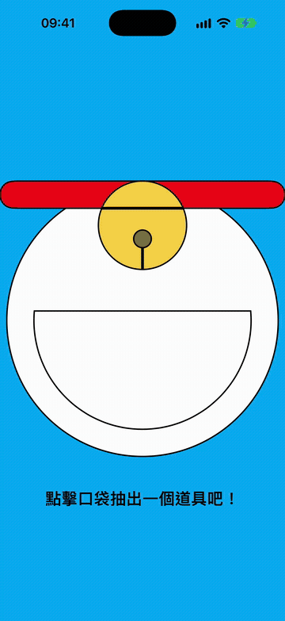
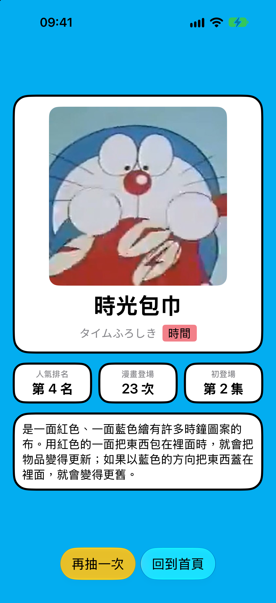

# 哆啦A夢的百寶袋 DoraemonGadgets

點哆啦A夢的口袋，隨機抽出一個道具，顯示道具的圖片、名稱、分類、人氣排名與介紹。

彼得潘 Swift 100 道謎題 [#226 隨機 App](https://medium.com/彼得潘的試煉-勇者的-100-道-swift-ios-app-謎題/226-隨機-app-7d59fe9b7491) 的練習作品。

  
  
  

## 功能

- 首頁用 SwiftUI `Shape` 畫出哆啦A夢的肚子、項圈、鈴鐺和口袋，在不同尺寸的 iPhone 上都置中
- 點口袋抽出道具，卡片從口袋翻轉放大出現
- 「再抽一次」：舊卡往左飛出，新卡從右邊滑入，不會連續抽到同一個道具
- 道具卡顯示圖片、中文名、日文名、分類、人氣排名、漫畫登場次數、初登場集數與說明
- 說明過長時才改成可以捲動

## 收錄道具

| 道具 | 日文名 | 分類 | 人氣排名 | 漫畫登場 | 初登場 |
|---|---|---|---|---|---|
| 任意門 | どこでもドア | 空間 | 1 | 106 次 | 短篇集第 6 集 |
| 竹蜻蜓 | タケコプター | 空間 | 3 | 329 次 | 短篇集第 1 集 |
| 翻譯蒟蒻 | 翻訳こんにゃく | 通訊 | 7 | 6 次 | 短篇集第 12 集 |
| 時光機 | タイムマシン | 時間 | 2 | 138 次 | 短篇集第 1 集 |
| 縮小燈 | スモールライト | 改變狀態 | 6 | 30 次 | 短篇集第 5 集 |
| 時光包巾 | タイムふろしき | 時間 | 4 | 23 次 | 短篇集第 2 集 |
| 記憶吐司 | アンキパン | 學業 | 5 | 1 次 | 短篇集第 2 集 |

## 專案結構

| 檔案 | 內容 |
|---|---|
| `Gadget.swift` | `Gadget` 資料型別與 `gadgets` 陣列 |
| `ContentView.swift` | 首頁與道具卡的切換、隨機抽取、抽卡 transition |
| `DoraemonBodyView.swift` | 哆啦A夢的肚子、項圈、口袋與點擊動畫 |
| `BellView.swift` | 鈴鐺 |
| `PocketShape.swift` | 口袋形狀（自訂 `Shape`） |
| `GadgetView.swift` | 道具卡片與 `InfoBadge` 數據格 |

## 開發環境

- Xcode 27.1
- iOS 27.0 以上
- SwiftUI

## 執行

1. 用 Xcode 開啟 `DoraemonGadgets.xcodeproj`
2. 選擇 iPhone 模擬器，按 ⌘R 執行

## 版權聲明

本專案僅為 Swift 課程練習，不做任何商業用途。

- 哆啦A夢角色、道具名稱與圖片版權屬藤子製作公司（藤子プロ）及各原權利人。
- 道具圖片、說明、排名與登場資料整理自[哆啦A夢中文網 道具．法寶百科](https://chinesedora.com/gadget/)。

如有侵權疑慮，請開 issue 告知，會立即移除相關內容。
